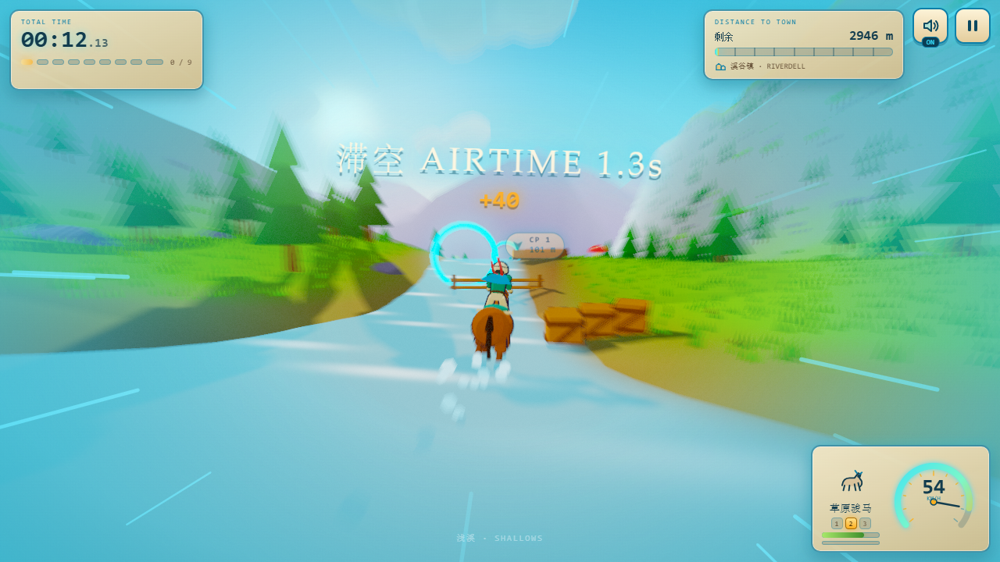

# 山谷速降 · Valley Downhill

> 单文件 3D 第三人称极限速降竞速游戏。从海拔 1450m 的苍翠高岭出发，沿 3200m 蜿蜒山道俯冲（全程约 2~3 分钟），
> 穿过 8 道检查点与松林、浅溪、断崖，抢在炊烟散尽之前抵达溪谷镇。

**本项目使用 Qoder 配置 Qwen4 生成。**


---

## 特性

- **零外部资产**：几何体、贴图、音频全部程序化生成，无图片 / 模型 / 字体 / 音频文件。
- **纯 Three.js 核心**：r160.1，不使用 `three/addons`（合并几何体亦为自实现）。
- **旷野之息 / 吉卜力风格**：三阶卡通着色 + 描边 + 自定义泛光与体积光柱。
- **三种可切换载具**：山地自行车 / 草原骏马 / 希卡悬浮板，手感与特技各异。
- **桌面 + 移动自适应**：同一份代码，键鼠与触屏摇杆双方案。
- **全中文 UI**，程序化 WebAudio BGM / 风声 / 载具音 / 音效。
- **站点版可完全离线**：引擎本地化，屏蔽外网后外部请求数 0，仍可完整通关。

## 画面截图

| 菜单 | 山地自行车 | 草原骏马 |
|---|---|---|
|  |  |  |

## 快速开始

**单文件版（便携分发）**
直接双击 `dist/山谷速降.html`。首次启动需联网从 CDN 加载 Three.js（主 jsdelivr → 备 unpkg），浏览器缓存后可离线。

**站点版（推荐，可完全离线）**
必须走 HTTP（ES module + importmap，不支持 `file://`）：

```bash
python3 -m http.server 8080
# 打开 http://127.0.0.1:8080/
```

引擎指向本地 `./three.module.js`，零外部依赖。

**从源码构建**

```bash
node tools/build.mjs                 # 拼接 src/ → index.html 与 dist/山谷速降.html
node --check dist/.bundle.check.mjs  # 语法校验，必须通过
```

`index.html` 与 `dist/` 均为构建产物，请勿手改；所有修改落在 `src/`。

## 操作

| 按键 | 功能 |
|---|---|
| `W / ↑` | 加速 |
| `S / ↓` | 刹车 |
| `A D / ← →` | 转向 |
| `空格` | 跳跃 |
| `Shift` | 冲刺加速 |
| 空中 `← ↑ ↓ →` | 翻转 / 转体 |
| `1 2 3 / Tab` | 切换载具 |
| `R` | 回检查点 |
| `P` | 暂停 |
| `M` | 静音 |
| 拖拽 / 滚轮 | 环绕 / 缩放相机 |

移动端为触屏摇杆 + 跳跃 / 冲刺 / 切换按钮。

## 载具

| 载具 | 定位 | 极速 (m/s) | 特点 |
|---|---|---|---|
| 山地自行车 | 均衡 | 15.5 | 蹬踏稳定、刹车灵敏，可主动小跳，适合新手 |
| 草原骏马 | 技巧 | 17 | 爆发冲刺耗体力、慢跑恢复，跳跃最高、特技窗口最长 |
| 希卡悬浮板 | 极速 | 18.75 | 最高速度与加速度，转向带漂移倾角，碰撞惩罚最大 |

## 架构简述

`src/` 八个分片由 `tools/build.mjs` 按文件名顺序字符串拼接为**同一个 module 作用域**
（`10-head.html` 打开 `<script type="module">`，`80-game.js` 关闭），分片间无 import/export，
顶层声明直接互见。地形生成用解析式 `heightField`，而**所有物理与摆放一律用 `heightAt`**
（读已加载区块高度栅格、按渲染同款对角线插值），保证物理站在「看见的那张三角面」上。

架构约定与硬性不变量详见 [AGENT.md](AGENT.md)。

## 部署

纯静态站点，无需构建服务：

- **GitHub Pages**：Settings → Pages → Source `Deploy from a branch` → `main` / root。
- **Netlify / Cloudflare Pages**：直接上传根目录，`_headers` 自动生效。

## 许可证

Three.js r160.1 随附上游 MIT 许可证，见 [LICENSE-THREE.txt](LICENSE-THREE.txt)（分发引擎必须保留）。